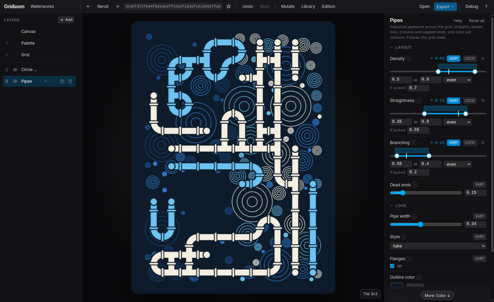

# Gridloom

A free, open-source studio for generative art built on a grid. You make a piece by stacking layers and moving sliders, not by writing code. Every picture is a **document** (your layers and settings) plus a **seed**, so the same pair always draws exactly the same image, in any browser.



Gridloom runs entirely in your browser. There is no account, no server and no tracking. It works offline once loaded and can be installed as an app.

> **Live site:** coming with the first deploy. Until then, run it locally (see [For developers](#for-developers)).

## Try it in two minutes

1. **Press `R` a few times.** Each press draws a new seed: the same settings, a different outcome. Left and Right walk back through the seeds you have seen.
2. **Open a preset.** Press `L` for the Library and pick one, such as **Knotwork** or **Bloom**.
3. **Change something.** Click a layer on the left, then move a slider on the right. Every setting has an **i** button that says what it does, and **Help** at the top of the panel shows them all.
4. **Let the seed decide.** Click **vary** on a setting: from now on each seed picks a value inside the range you set. Press `R` again to see the range at work.
5. **Explore.** Press `M` for the mutation grid: eight variations of your piece around it. Click one to make it the new centre, and keep walking.
6. **Keep it.** Press `B` to star a seed you like, and use **Export** to save an image, the document or a share link.

Press `?` at any time for every keyboard shortcut.

## Core ideas

**Seed.** A 64-character code that drives every random choice in the piece. A new seed is a new outcome of the same design. Seeds you star (`B`) appear in a strip under the canvas.

**Layers.** A piece is a stack of layers that run top to bottom. Each layer is a *module* (Grid, Tiles, Maze...) with its own settings. The stack has three parts:

- **Pinned at the top:** Canvas, Palette and Grid. Every drawing layer depends on them, so they cannot be moved, removed or hidden.
- **Free in the middle:** the drawing layers, in any order. A second Grid, Palette or Symmetry here becomes a **Re-grid** (the layers below it draw on its cells), a **Re-palette** (new colors for the layers below) or a **Mirror** (mirrors only what is above it).
- **Pinned at the end:** Symmetry, then Post. Optional, but always last when present.

**Fixed or varying.** Every setting is either fixed (you choose the value) or varying (**vary**: the seed chooses). A varying number takes a range and a shape for how values spread inside it:

| Spread | Means |
|---|---|
| even | every value in the range equally likely |
| lean low / lean high | values gather toward the low or the high end |
| middle | values gather around the centre |

A varying choice (a palette, a shape) takes **weights** instead: the bars show each option's chance. **lock** pins a varying setting to its fixed value without forgetting the range.

**Color rules.** Most drawing modules pick colors by one of these rules:

| Rule | Picks |
|---|---|
| contrast | palette colors that stand out from what is underneath |
| zone | the colors of the palette zone at that spot (Palette > Zones) |
| palette | any palette color |
| single | the one color you set |
| ramp | steps through the palette in order, low to high or centre to rim (some modules) |

## Modules

Add layers with **+ Add**. Settings for each module are grouped, explained by their **i** buttons, and only shown when they apply in the current mode.

**Setup** (pinned)

| Module | What it does |
|---|---|
| Canvas | Format, margin and background. Always the first layer. |
| Palette | Chooses the colors and splits the canvas into color zones. |
| Grid | Lays out cells inside the frame, with optional subdivision and a mask (circle, diamond, noise) that removes cells. |

**Drawing on the grid** (they need a Grid above them; the layer list warns you if not)

| Module | What it draws |
|---|---|
| Cell fill | Fills cells with palette colors: squares, rounded squares or circles. |
| Insets | Concentric squares or circles nested inside cells. |
| Tiles | Truchet tiles (arcs, diagonals, triangles, quarter discs) rotated per cell. Arcs join up into continuous curves. |
| Circuits | Circuit-board wires routed along the grid, capped with terminals. |
| Maze | A maze carved through the grid, drawn as walls or as the corridors. |
| Halftone | A dot, square or diamond in every cell, sized by noise, distance from the centre, a gradient or chance. |
| Hatching | Parallel or crossed lines inside each cell. Single strokes, made for pen plotters. |
| Celtic knot | Interlaced knotwork, over and under. Breaks turn plain plaitwork into separate knots. |
| Pipes | Pipework with bends, tees, crosses and capped ends, one color per connected network. |

**Free-form** (they use the frame, and the grid mask if you want)

| Module | What it draws |
|---|---|
| Flow | Streamlines that follow the contours of a noise field. |
| Contour | Topographic lines of a noise landscape, optionally sheared by fault lines. |
| Circle packing | Circles that fill the frame without touching: filled, ringed or as concentric ripples. |
| Threads | Threads sagging between the frame edges: a web, a loom's warp, or hammocks. |
| Phyllotaxis | Sunflower spirals at the golden angle, one large or one per cell. |
| Spirograph | Gear-wheel curves that close on themselves, or harmonograph pendulum traces. One large or one per cell. |
| Waves | Chladni plate figures (the patterns of a vibrating plate) or interference rings. |
| Attractor | A strange attractor (Clifford or de Jong): one point hopping thousands of times, drawn as a cloud of dots. |

**Finishing** (pinned at the end)

| Module | What it does |
|---|---|
| Symmetry | Mirrors or rotates everything the layers above it have drawn. |
| Post | Hand-made jitter, an optional border, and film grain on top. |

**Presets** (Library, `L`): Starter, Breadboard, Weave, Quilt, Nest, Totem, Labyrinth, Currents, Knotwork, Topography, Waterworks, Specimens, Resonance, Bloom and Chaos. Each one varies with the seed; open one and press `R`.

## Features

- **Mutation grid (`M`).** Eight variations around your piece; click one to adopt it and keep exploring. Set how far they stray, limit them to the selected layer, or give each its own seed.
- **Breeding.** In the mutation grid, switch to **Breed** and pick a partner preset: each child takes every setting from one parent or the other. Your locked settings never change.
- **Favourites (`B`).** Stars the current seed. The strip under the canvas draws every starred seed with your *current* settings, so one edit previews across all of them. A star keeps the seed only: to keep a finished piece, save it to the Library or copy its link.
- **Library (`L`).** Built-in presets plus your own saved pieces.
- **Tile preview (`T`).** Shows the piece repeated 3x3, to check that a pattern's edges join. Set the Canvas margin and corner radius to 0 for a seamless repeat.
- **Undo and redo (`Ctrl+Z`, `Ctrl+Shift+Z`).** Every edit, including resets. A dot next to the name means there are changes you have not saved.
- **Reset.** The circular arrow on a setting returns it to the default; **Reset all** does the whole layer.
- **Code.** In the settings panel, **Code** shows the source that draws the selected layer, with a short guide to reading it. Every look in Gridloom is a small, commented file: a first step into generative art coding. **Remix** makes that code your own as a script layer.
- **Script layers.** **Add > Script** makes a layer drawn by your own code. See [Write your own layer](#write-your-own-layer).
- **Export.** PNG at 2000 or 4000 px (re-rendered, never upscaled), SVG, the document as a `.gridloom.json` file, and a share link.
- **Edition (`E`).** Tools for long-form editions: traits and rarity, a census over many seeds, a contact sheet, batch export, pen plotter export and a self-hosted mint export. See [Long-form workflow](#long-form-workflow).
- **Plotter export (Edition > Plotter).** An SVG for pen plotters on A5, A4, A3 or Letter: every shape becomes its outline, one layer per color (one pen each), with the drawing distance and an estimated plotting time. Filled shapes are outlined, not shaded: add a Hatching layer for shading. Grain is left out unless you ask for it, and dot drawings (Attractor) plot as one pen tap per dot, which can take hours.

## Write your own layer

**Add > Script** adds a layer drawn by your own JavaScript, then **Edit code** opens it under the canvas. It starts with a commented example (rings in every grid cell) that you can change line by line; the picture redraws about half a second after you stop typing.

```js
layer({
  label: "Rings",
  params: {
    rings: { kind: "int", label: "Rings", help: "How many rings in each cell", min: 1, max: 12, default: 4 },
  },
  apply(scene, v, ctx) {
    const rng = ctx.rng("rings");
    const items = [];
    for (const cell of scene.cells) {
      // ... push { type: "circle", cx, cy, r, stroke: "#1d3557" } and friends
    }
    return addItems(scene, items);
  },
});
```

- **params** become settings in the panel, with vary, lock, traits and the mutation grid, exactly like the built-in layers. The kinds are `number`, `int`, `enum`, `bool` and `color`.
- **apply(scene, v, ctx)** runs once per picture. `v` holds this seed's settings, `ctx.rng("name")` gives numbers the seed decides, and `Math.random` follows the seed too.
- **Shapes** are `rect`, `circle`, `polyline` and `dots`, measured so that the short side of the canvas is 1. Exports, plotter SVG and share links work as for any layer.
- **Helpers** are the ones the built-in layers use: `addItems`, `dsin`, `dcos`, `TAU`, `makeNoise2D`, `chance`, `int`, `shuffled`, `pickColor` and more. The editor lists them. Use `dsin` and `dcos` rather than `Math.sin` and `Math.cos`: the editor warns about math that can differ slightly between browsers.
- **Remix a built-in layer.** In any drawing layer's **Code** view, **Remix** turns that layer into a script layer with the module's own code, comments included. It draws exactly the same picture until you change something, and undo turns it back.
- **Mistakes are safe.** An error shows its line, and the last working version keeps drawing until the code works again.
- **Isolated.** Scripts run in a sandbox: a separate, locked-down page with no network access and no way to see your Library or other saved data. A script that runs too long is stopped.
- **Code from other people waits for a yes.** When a share link, an opened file or an imported Library entry brings script code you have not run before, the picture leaves those layers out and a notice offers **Run the code**, **Show the code** (to read it first) or **Keep hidden**. Code you write or remix, and code you have approved, runs without asking in this browser.
- **Batch and mint export** work with script layers. Batch draws each piece in the sandbox, one at a time. A minted `index.html` carries the code and a 3 KB compiler, and runs it in its own page like any generative piece; its content security policy then allows compiling code (`'unsafe-eval'`), which pieces without script layers never get. Code must be yours or approved before it can be minted.

## Shortcuts

| Key | Does |
|---|---|
| `R` | new random seed |
| Left / Right | previous / next seed (the trail is remembered) |
| `C` | copy the seed |
| `B` | star the seed |
| `S` / `Shift+S` | PNG at 2000 / 4000 px |
| `G` | debug panel (seed, timing, resolved values) |
| `F` | fullscreen viewport |
| `T` | tile preview (3x3) |
| `Ctrl+Z` / `Ctrl+Shift+Z` | undo / redo |
| `M` | mutation grid (1-9 adopt, `R` shuffle, `Esc` close) |
| `L` | library |
| `E` | edition |
| `Alt+Up` / `Alt+Down` | move the focused layer |
| `?` | every shortcut, in one list |

## Where your work lives

There is no server. A piece is kept in three ways, and only two of them last:

- **Share link** (Export > Copy share link, or the address bar): the document and seed live in the URL. Lasting.
- **Saved file** (Export > Save document): a `.gridloom.json` file you keep. Lasting. Open it again with **Open**.
- **Library, "Yours"**: stored in this browser, for this one site address only. Pieces saved on `localhost` do not appear on the deployed site, and moving the site to another domain leaves them behind. Clearing site data, private windows, or Safari's cleanup of sites you have not visited recently can delete them. Use **Export all** in the Library for a backup, and **Import** to bring them into another browser.

Favourites and preferences (folded sections, the Help toggle) are also kept per browser.

## Good to know

- **Browsers.** A recent Chrome, Edge or Firefox, or Safari 16.4 or later. Older browsers get a notice instead of a broken page.
- **Phones and tablets.** Usable: the layer and settings panels become bottom sheets. A desktop screen is the comfortable place to work.
- **Same picture everywhere.** A document and seed produce the same shapes, positions and colors in every browser and on every machine; this is tested on every change. Pixel edges can still differ very slightly between browsers (anti-aliasing), so compare exports from the same browser when that matters.
- **Links keep settings, not images.** A share link stores your settings and seed and redraws them. If an update ever changes how an existing module draws, older links show a notice that they may look different. Gridloom guards against this with frozen reference outputs; changes are deliberate and announced.
- **Limits.** Up to 32 layers. Some settings are heavy and slow the preview: Attractor points, Contour and Waves resolution, Circle packing attempts, many cells with Spirograph or Phyllotaxis in cell mode.
- **Mint export** writes a self-hosted `index.html`. Adapters for specific platforms (Art Blocks, fx(hash) and others) are not available yet.

## Privacy and licence

- **Privacy.** Nothing you make leaves your device unless you share it: no accounts, analytics or cookies. Opening a share link sends nothing anywhere either; the piece is decoded in your browser.
- **Your work is yours.** Images, documents and exports you make with Gridloom belong to you; use them however you like, including commercially.
- **The code** is MIT licensed. **The palettes** are original and released as CC0.

## Long-form workflow

For an edition (many outputs of one design, one per seed), open **Edition** with `E`.

1. Build the piece and decide the traits: 4 to 8 axes, values as words.
2. **Settle the rarity table first.** Each seed picks a value by where its random number falls along the weights, so changing one weight moves the boundaries and many seeds switch value, not only rare ones. A seed you liked can change palette after a rarity tweak. (Share links and saved files carry their own weights, so they keep looking the same.)
3. Run a census at the edition size and fix anything flagged: values that never appear, one value at 80% or more, values expected less than once.
4. Look at many outputs on the contact sheet, then pick favourite seeds.
5. Freeze the document before any mint or public sharing, and export with Batch (PNGs, a manifest with seeds and traits, and the document).

## Self-hosted release (Edition > Mint export)

Exports one file named `index.html` (about 35 to 50 KB) with the player engine, only the modules the piece uses, the document frozen as it is, and a header documenting the seed format, traits and weights, licences and the suggested capture size. It follows a minimal contract that most tools understand:

- **Seed in:** `?hash=` (exactly 64 hex, optional `0x`), or `#hash=`. Without one, a random seed is chosen and written into the address bar. Anything else is rejected, never padded: `window.gridloomError` is set and a `genart:error` event fires.
- **Size:** `?width=` or `?height=` fixes that side in pixels and the other follows the aspect; both together fit the piece inside that box. Without them it fits the window, and resizes redraw the same piece. Capped at 8192 px a side and 16.7 megapixels so every current browser can draw it.
- **Features out:** `window.$features`, computed from the seed before anything is drawn.
- **Done:** `window.rendered` (the canvas) and a `genart:done` event, once per seed, when its frame is complete.
- **Entry point:** `window.render(hash)`, and `window.gridloom.svg()` for the same piece as SVG.
- **Offline:** a Content-Security-Policy blocks every network request. The e2e test opens the file with the network disabled and checks that features and the display list match the studio byte for byte, plus an A-B-A render, the error signal, sizing, and non-ASCII names.

Host it somewhere permanent (IPFS with a pinning service you pay for, or Arweave); a personal domain is mortal. Freeze the rarity table before exporting.

## For developers

### Run it

```
pnpm install
pnpm build && pnpm preview                   # production build served locally
pnpm --filter @gridloom/studio exec vite     # dev server with hot reload
pnpm -r test                                 # unit tests, including the frozen reference outputs
pnpm typecheck
pnpm e2e                                     # Chromium, Firefox and WebKit, incl. cross-engine determinism
node packages/core/scripts/render.ts 9 out   # SVG previews of the starter document
```

### Layout

```
packages/core     pure TS, zero runtime deps; the engine, modules and presets. Ships inside mint exports.
packages/runtime  the player for exported pieces (an engine plus one script per module) and the HTML assembler
apps/studio       Vite + React 19 + Tailwind 4 static app (PWA)
```

### Core concepts

- **Document:** an ordered stack of layers. Each layer names a module and holds its param settings.
- **Param setting:** a fixed `value`, plus an optional `vary` (range with a distribution, or weights), plus `locked`.
- **Hash:** 64 hex chars. Every layer, param and draw domain gets its own named sub-stream, so adding something never reshuffles the rest of an edition.
- **Display list:** modules emit primitives in normalised space (short side = 1), and renderers scale once.

### Determinism rules

Enforced by tests:

- No `Math.random`, `Date.now`, `performance.now` or `crypto` in `packages/core/src`.
- `packages/core/test/golden.test.ts` freezes the output of every existing module. If it fails, an existing module now draws differently, which changes saved links: restore the old output (put new behaviour behind a param whose default keeps it), or bump `ENGINE_VERSION` in `packages/core/src/version.ts` and regenerate with `UPDATE_GOLDEN=1 pnpm test`.
- Every built-in preset is drawn in Node, Chromium, Firefox and WebKit and the display lists must match byte for byte (`e2e/determinism.spec.ts`).

- Drawing code uses only `+ - * /`, `Math.floor`, `Math.round`, `Math.sqrt`, `Math.abs`, `Math.min` and `Math.max`. Engines are not required to agree on the last bit of `Math.sin`, `Math.cos`, `Math.exp`, `Math.pow`, `**`, `Math.atan2` or `Math.hypot`, so a test (`generate.test.ts`) rejects them anywhere in `packages/core/src`: use `dsin` and `dcos` from `packages/core/src/math/trig.ts`, which do agree. A line that only feeds text on screen can opt out with the comment `determinism: display only`.

By convention (review them in every change to `packages/core`):

- Draw a fixed number of random values per cell, line or attempt, before any early return, so changing one probability does not reshuffle everything after it. Or give the varying part its own named stream.
- Layer ids name random streams: never reuse or renumber them.

### Adding a module

1. Create `packages/core/src/modules/<id>.ts` with `defineModule({ id, label, description, params, apply })`.
2. Give every param a `label`, a `help` text (a test requires it), a `group` for its section, and `showIf` when it only applies in some modes. Use `colorHelp()` for a Color setting.
3. In `apply(scene, values, ctx)`, read `scene.frame`, `scene.cells`, `scene.lattice` and `scene.palette`, draw with `addItems`, take randomness from `ctx.rng("label")` streams, and pick colors with `pickColor` and `colorLookup` from `modules/color.ts`.
4. Register it in `packages/core/src/modules/registry.ts`. If it draws into grid cells, add its id to `GRID_USERS` in `apps/studio/src/state/layerOrder.ts`, so the studio warns when no Grid runs above it.
5. Test its invariants, add entries to `packages/core/test/golden.test.ts`, and run `UPDATE_GOLDEN=1 pnpm test`: the diff of `golden.json` must only add entries.
6. Add a built-in preset that uses it (with at least 3 traits), so the cross-engine check covers it.

The studio builds the settings panel, the Add menu entry, mutation, breeding, traits and plotter support from the module definition alone, and the mint player build (`packages/runtime/scripts/build.ts`) gives it its own small script from the registry, so a minted piece only carries the modules it uses.

### Deploy

Push to `main`. The GitHub Actions workflow typechecks, tests, builds `apps/studio` and publishes it to GitHub Pages. In the repo settings, set Pages to "GitHub Actions" once. There is no server, database or secret to maintain.

Security settings that depend on the host:

- **Content security policy.** Built pages carry their own policy in a `<meta>` tag (scripts, workers and data only from the site itself; no plugins; the only frame is the script sandbox). The dev server runs without it.
- **Response headers.** `public/_headers` is read by Cloudflare Pages and Netlify (other hosts ignore it). It keeps the studio out of other sites' frames, and forces `sandbox.html` into an isolated origin even when it is opened directly. GitHub Pages cannot set headers; the pages then rely on their own checks, which hold, but the headers are a second layer.
- **The script sandbox on its own origin (recommended).** Serve the same `sandbox.html` from a second origin (another domain or subdomain with nothing else on it), and build with `VITE_SANDBOX_URL=https://that-origin/sandbox.html`. The browser then runs scripts in a separate process, so a script that exhausts memory cannot take the studio's tab down with it. Allow the studio's origin in that host's `frame-ancestors` (see `_headers`).

## History

- **Engine:** seeded PRNG with named sub-streams, the param system, the display list, SVG and Canvas2D renderers, engine versioning and frozen reference outputs.
- **Studio:** layer stack, generated settings with help, vary and lock, rendering in a Web Worker, URL state, exports, undo, shortcuts, offline PWA, mobile layout.
- **Exploration:** mutation grid, breeding, preset library, favourites, tile preview.
- **Long-form:** traits and rarity, census, contact sheet, batch export, cross-browser determinism check, self-hosted mint export, pen plotter export.
- **Modules:** 22, from Grid and Tiles to Celtic knot, Pipes, Waves and Attractor, on deterministic `dsin`/`dcos`.

## Credits

Techniques used (grid subdivision, Truchet tiling, orthogonal routing, value noise, marching squares, wave function collapse, Vogel's phyllotaxis model, Clifford and de Jong attractors, Chladni figures) are shared heritage, and every module here is written from scratch. The PRNG is sfc32 (Chris Doty-Humphrey, PractRand), seeded per the genart determinism notes. Palettes are original and released as CC0.
